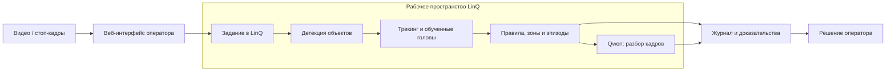

<div align="center">
  
  <h1>LinQ Safety</h1>
  <p><strong>Видеоаналитика промышленной безопасности на платформе LinQ</strong></p>
  <p>От видеозаписи — к объектам, событиям и решению оператора.</p>
  <p>
    <a href="https://github.com/chrizantona/linQ/actions/workflows/checks.yml"></a>
  </p>
  <p>
    <a href="#возможности">Возможности</a> ·
    <a href="#архитектура">Архитектура</a> ·
    <a href="#быстрый-старт">Запуск</a> ·
    <a href="docs/REQUIREMENTS.md">Соответствие ТЗ</a>
  </p>
</div>

---

**LinQ Safety** — сервис для разбора видео и последовательностей стоп-кадров. Он выделяет людей, телефоны и сигареты, отслеживает объекты, объединяет повторные сигналы в эпизоды и показывает оператору кадры, время, камеру и объяснение события.

Нейросетевой анализ выполняется в рабочем пространстве **LinQ**. На компьютере оператора работают веб-интерфейс и управление заданиями. Результат модели и решение человека хранятся раздельно.

## Возможности

| Возможность | Что получает оператор |
| --- | --- |
| **Объекты в кадре** | Рамки людей, телефонов и сигарет, идентификаторы треков и список найденных объектов. |
| **Телефоны и сигареты** | Отдельные профили присутствия предмета и проверки действия. Для телефонов используются полный кадр и области вокруг людей; для сигарет — отдельный RF-DETR. |
| **Шесть обученных задач** | Падение, бег/ходьба, направление подъёма груза, сближение человека с погрузчиком, человек под подвешенным грузом и наличие страховочной привязи. |
| **Две камеры** | Одно задание с двумя видеозаписями; переключение источника вместе с его рамками и эпизодами. |
| **Полигональные зоны** | Проверка входа человека в заданную область по положению нижней точки рамки. Сохранённая зона применяется к будущим запускам. |
| **Журнал событий** | Фильтры по типу, камере, зоне и времени относительно начала источника. Повторные срабатывания одной камеры и правила объединяются в эпизод. |
| **Проверка оператором** | Подтверждение, отклонение или неопределённый результат с комментарием; экспорт решений в CSV/JSONL. |
| **Стоп-кадры** | Набор из 2–24 JPEG/PNG, переключение исходных изображений и сохранение их контрольных сумм. |

Кандидат события появляется после получения детекций, до завершения дополнительного текстового разбора. В карточке можно просмотреть источник, рамки и доказательные кадры, затем сохранить собственное решение.

## Архитектура



| Этап | Модель / метод | Исполнение |
| --- | --- | --- |
| Люди | RF-DETR, скомпилированная программа | **TPU LinQ** |
| Телефоны | YOLO26m ONNX, полный кадр и области людей | CPU LinQ |
| Сигареты | RF-DETR ONNX, полный кадр | CPU LinQ |
| Классификация клипа | ConvNeXt-Tiny и шесть обученных линейных голов | CPU LinQ |
| Разбор события | Qwen3.5-0.8B Q4 через llama.cpp; включается отдельно | CPU LinQ |
| Сопоставление объектов | Фильтр Калмана и IoU | Процесс пайплайна в LinQ |

Подробности входных данных, границ исполнения и структуры результатов — в [описании архитектуры](docs/ARCHITECTURE.md).

## Быстрый старт

Нужны **Python 3.12 или 3.13**, `ffmpeg`, доступ команды к LinQ/Jupyter и архив моделей `linq-models-v2.tar.gz`. Для изолированного VPN-подключения используется Docker. Node.js нужен только для тестов фронтенда.

### 1. Получить исходники и зависимости

```bash
git clone https://github.com/chrizantona/linQ.git
cd linQ
python3 -m venv .venv
.venv/bin/python -m pip install -r deploy/requirements-web.txt
```

### 2. Установить модели и примеры

Веса передаются отдельно от Git. Установщик проверяет размер и SHA-256 архива, а затем каждый файл по [манифесту](assets.json).

```bash
.venv/bin/python scripts/install_assets.py --bundle /path/to/linq-models-v2.tar.gz

# Необязательно: пять демонстрационных роликов с Pexels.
.venv/bin/python scripts/install_demo_examples.py
```

Демонстрационные материалы скачиваются и обрезаются локально. Их источники, авторы и контрольные суммы записаны в [манифесте примеров](examples/media_sources.json). Начальный каталог не содержит готовых предсказаний.

### 3. Подключиться к LinQ

Используйте выданный команде профиль. Пароли запрашиваются интерактивно; файлы сессии сохраняются в игнорируемой Git папке `.secrets/`.

```bash
.venv/bin/python scripts/connect_linq_docker.py start --profile /path/to/authorized-linq.ovpn
.venv/bin/python -m deploy.configure_access --base-url http://hackathon.lin-q.ru:18184/ --address 127.0.0.1 --websocket-origin http://hackathon.lin-q.ru/
.venv/bin/python scripts/provision_linq.py --setup
```

Для дополнительного разбора кадров запустите службу в **терминале LinQ/Jupyter**:

```bash
cd ~/work/mosprom_hackathon_linq
.venv/bin/python scripts/linq_prototype.py start-vlm
```

Полная подготовка среды, проверка подключения и остановка VPN описаны в [SETUP](docs/SETUP.md).

### 4. Открыть интерфейс

На компьютере оператора:

```bash
.venv/bin/python -m deploy.demo_web --host 127.0.0.1 --port 4184
```

Откройте **http://127.0.0.1:4184/**. Выберите видео или стоп-кадры, профиль обработки и нажмите «Запустить». Для готового примера можно открыть его в очереди и запустить разбор. Сервис рассчитан на локальную работу одного оператора; публичное размещение требует отдельной авторизации.

## Проверка решения

```bash
.venv/bin/python -m pip install -r requirements-dev.txt
.venv/bin/python -m pytest -q
npm test --prefix service
```

Локальные тесты проверяют пайплайн, интерфейс, обработку входных данных, установку артефактов и доступ к LinQ через имитации транспорта. Реальные выполнения моделей подтверждаются отдельными записями:

- [Повторная проверка очищенного кода](provenance/publication-runtime-validation.json): телефон, сигарета и падение на LinQ.
- [Проверенные сценарии](provenance/service-features.json): телефоны, сигареты, контрольные примеры, зоны, две камеры, набор изображений и фильтры журнала.
- [Запуски на LinQ](provenance/linq-verification.json): контрольные суммы входов и моделей, ответы TPU, CPU-этапы и результаты.
- [Ранние события](provenance/progressive-candidates.json): кандидат в журнале до завершения полного разбора.
- [QA](QA.md): команды, результаты проверок и известные ограничения.

## Границы текущей версии

Решение обрабатывает загруженные записи и наборы изображений. Присутствие телефона или сигареты само по себе не подтверждает действие или нарушение; мелкие и перекрытые предметы могут пропускаться, возможны ложные рамки. Неподкреплённый детекциями вывод текстовой модели остаётся неопределённым.

Время стоп-кадров синтетическое: порядок изображений не используется как доказательство движения. Живые RTSP-потоки, нагрузка сотен камер и точность на репрезентативной размеченной выборке не проверены. Соответствие отдельным пунктам кейса и оставшиеся ограничения отражены в [матрице ТЗ](docs/REQUIREMENTS.md).

## Структура репозитория

```text
service/       интерфейс оператора и его тесты
deploy/        пайплайн LinQ, модели исполнения и веб-сервис
scripts/       установка моделей, подключение и подготовка LinQ
demo/          трекинг, правила и рендер результатов
tests/         проверки установки, запуска и обработки материалов
examples/      манифест исходных демонстрационных роликов
provenance/    обезличенные записи проверенных запусков
docs/          запуск, архитектура и матрица требований
licenses/      уведомления о сторонних компонентах
```

Код и дизайн развивают [исходный проект команды](https://github.com/cutroy/mosprom_hack), версия `09ecbd3`; происхождение записано в [provenance/source.json](provenance/source.json). Лицензия проекта находится в [LICENSE](LICENSE), условия моделей, библиотек и данных — в [THIRD_PARTY_NOTICES](THIRD_PARTY_NOTICES.md).
